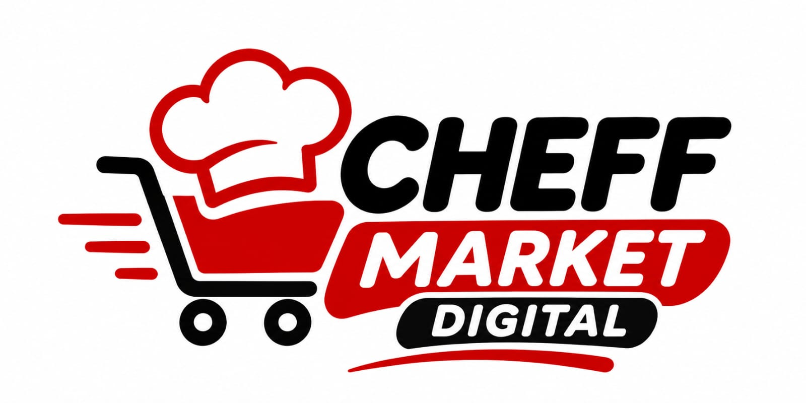

# 🎃 Cheff Market Digital del Terror 🔪
> **Marketplace Gastronómico de Fantasía de la Tribu TI Digital para el Concurso de Halloween 2026**



Bienvenido a la experiencia oficial del **Cheff Market Digital del Terror**, un marketplace frontend temático diseñado y desarrollado especialmente para que el Squad de la **Tribu TI Digital** se lleve el primer lugar en el concurso de Halloween 2026.

---

## 👻 Características Principales

### 👨‍🍳 1. El Squad de los 28 Chefs del Terror
- Galería interactiva con las fotografías oficiales de los **28 integrantes** de la Tribu TI Digital en trajes culinarios y portando sus cuchillas de precisión.
- Cada chef cuenta con su rol técnico, equipo, nivel de peligro/terror (%), plato de especialidad macabro, arma culinaria y ficha técnica detallada.
- Filtros por áreas: *Liderazgo & Tech Leads, Backend & Data, Frontend & UI, DevOps & Cloud, QA & Seguridad*.

### 🛒 2. Despensa Gastronómica Maldita (Catálogo de Productos)
- **Frutas del Más Allá:** Manzanas Envenenadas, Naranjas Sangrientas de Transilvania, Uvas Ojo de Cíclope, Fresas Corazón de Zombie, Plátanos Espectrales.
- **Verduras & Cosechas Cursadas:** Calabazas Jack-o'-Lantern, Zanahorias Moradas Nosferatu, Pimientos del Averno, Setas Portobello de Bruja.
- **Pócimas & Elixires:** Cóctel Sangre de Dragón TI con glitter comestible, Elixir Ectoplasma Radioactivo 404, Cerveza Stout del Averno 666, Vino Tinto Ultratumba 1666.
- **Carnicería & Cocina Gourmet:** Hamburguesa Necromancer Black Angus (pan negro), Dedos de Bruja Crujientes, Costillar Ahumado de Sepulturero, Pizza Negra Sangrienta.
- **Repostería Diabólica:** Red Velvet Terciopelo Sangriento, Donas Cerebro Zombi con glaseado de fresa, Galletas Catrinas de Chocolate.
- Búsqueda instantánea, filtros por categoría y ordenamiento por precio o nivel de terror.

### 🛍️ 3. Carrito de Compras Independiente por Sesión ("Caldero")
- Carrito con persistencia en `localStorage` (independiente para cada usuario y sesión en web o móvil).
- Control de cantidades (+ / -), cálculo automático de subtotales e impuestos del inframundo.
- Cupón de descuento interactivo: ingresa `SQUADTI` para un 20% de descuento demoníaco.

### 💳 4. Pasarela de Pago Simulada (CursedPay 666)
- Simulación realista de pasarela de pago para una experiencia de compra completa sin cargos reales.
- **Previsualización 3D interactiva de la tarjeta** que se actualiza en tiempo real al escribir el número PAN, nombre del titular, fecha de expiración y CVV.
- Botones de autocompletado rápido: *Visa Fantasma, MasterCursed, Amex Vampiro*.
- Simulación de validación con animación de procesamiento en 3 etapas.
- **Comprobante de venta oficial** con número de orden `#HELL-XXXXXX`, desglose itemizado, blast de confeti de Halloween y opción de impresión/descarga.

### 🎵 5. Reproductor de Música Estilo Spotify
- Barra inferior fija estilo Spotify con estética Dark Horror y acentos rojo sangre.
- 9 pistas musicales originales de Halloween:
  1. *La cocina del terror*
  2. *Baila con el lag*
  3. *Halloween en la tienda*
  4. *El fantasma del servidor*
  5. *Cuchillos y soldadores*
  6. *Abrazo espectral*
  7. *La tienda esta en llamas*
  8. *Billetera muerta en el callejón*
  9. *La leyenda de los chefs*
- Controles completos: Reproducir/Pausar, Anterior, Siguiente, Barra de progreso interactiva (seekable), Control de volumen, Mute y ecualizador visual dinámico.
- Drawer de Playlist para ver y seleccionar cualquiera de los temas.

### 🦇 6. Efectos de Sonido y Atmósfera Inmersiva
- Sintetizador de efectos Web Audio API (cuchillo afilándose al agregar al carrito, burbujeo de caldero, campana fantasmal, fanfarria de victoria al pagar).
- Murciélagos animados flotando en el fondo y diseño 100% responsivo para móviles y ordenadores.

---

## 🛠️ Tecnologías Utilizadas

- **Framework:** React 19 + TypeScript + Vite 6
- **Estilos:** Tailwind CSS 3 (tema personalizado con paleta de colores de Halloween y sangre de chef)
- **Iconografía:** Lucide React
- **Audio:** Web Audio API (efectos de sonido sintetizados) + HTML5 Media Audio (reproductor MP4)
- **Efectos:** Canvas Confetti

---

## 🚀 Despliegue en Vercel

1. Ingresa a [Vercel](https://vercel.com/new).
2. Conecta tu cuenta de GitHub y selecciona el repositorio **`cheff-market-digital`**.
3. Vercel detectará automáticamente la configuración de Vite y ejecutará:
   - **Framework Preset:** Vite
   - **Build Command:** `npm run build`
   - **Output Directory:** `dist`
4. ¡Haz clic en **Deploy** y obtendrás tu URL pública al instante!

---

## 💻 Ejecución Local

```bash
# 1. Clonar el repositorio
git clone https://github.com/AngelQS/cheff-market-digital.git

# 2. Entrar a la carpeta
cd cheff-market-digital

# 3. Instalar dependencias
npm install

# 4. Iniciar servidor de desarrollo
npm run dev
```

Abre en tu navegador: [http://localhost:3000](http://localhost:3000)

---

🎃 **¡Desarrollado con orgullo y creatividad culinaria por la Tribu TI Digital!** 🔪
